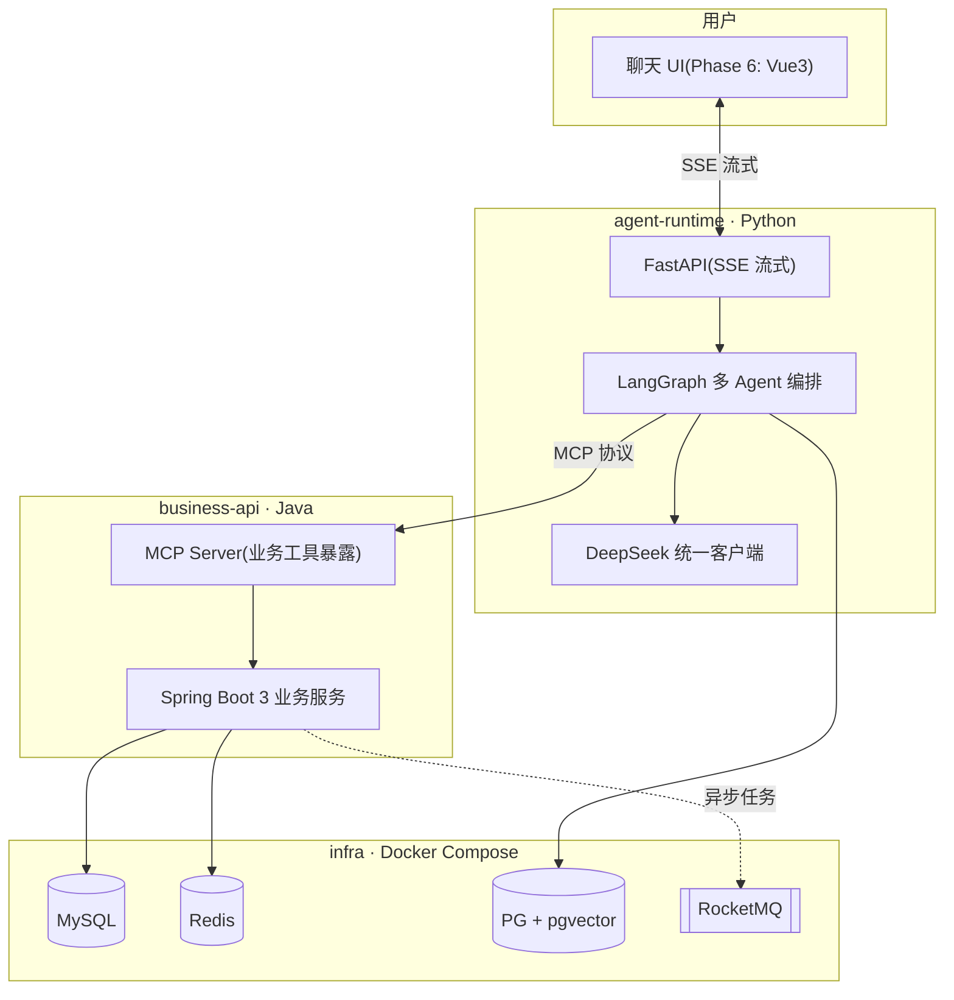

# 智购助手 shop-copilot

企业级电商智能导购 Agent 平台:多 Agent 协作 + RAG + MCP 双语言架构。

- `business-api/` Java (Spring Boot 3) 业务服务,通过 MCP 暴露业务工具
- `agent-runtime/` Python (FastAPI + LangGraph) Agent 编排运行时
- `infra/` Docker Compose 基础设施

## 架构图

